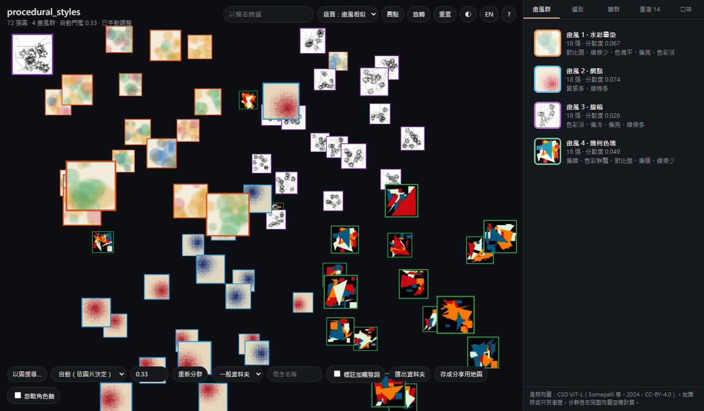
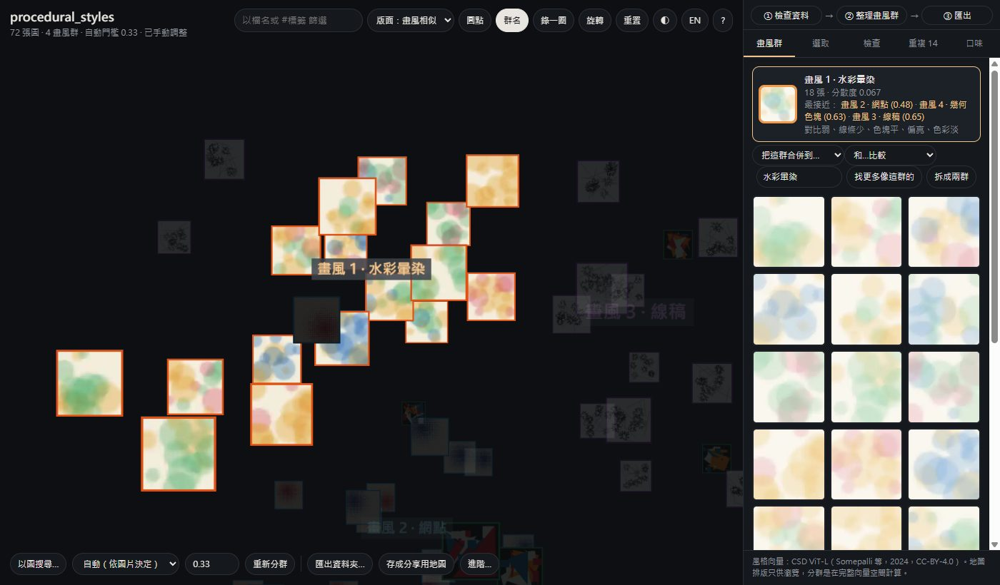

# style-atlas

**量化、聚類、搜尋與視覺化插畫畫風。全部在本機運算。**
Measure, cluster, search and map illustration art styles, entirely on your machine.

[繁體中文](#繁體中文) · [English](#english)

---

## 繁體中文

style-atlas 會看每張圖「怎麼畫」（不是畫了什麼），自動把畫風相近的圖分在一起。它用 CSD 這個畫風辨識模型，把每張圖轉成一組「畫風特徵」，再拿這些特徵做下面幾件事：

| 你想做的事 | 怎麼做 |
|---|---|
| **訓 LoRA 前整理資料集**：分出不同畫風，或把同一位畫師分成幾個時期，排除重複圖與離群圖，匯出成 kohya 資料夾 | `cluster --layout kohya --dedupe`（分時期加 `--granularity period`），或網頁介面的「匯出資料夾」 |
| **找畫風相近的圖**：一張或同畫風的幾張圖當範例，也能把結果直接複製成資料夾 | 網頁介面拖圖進去，或用 `search`（`--combine`、`--copy-to`） |
| **這張圖像哪位畫師？**：圖庫按畫師（或畫風）分資料夾時，列出最像的資料夾 | `search --by-folder` |
| **3D 畫風地圖**：縮圖浮在 3D 空間，可轉動，點一下就看最接近的畫風 | `map`，或網頁介面的「存成分享用地圖」（單一 HTML 檔，可直接傳給朋友） |
| **檢查資料集**：解析度、小圖放大、壓縮太重、極端比例、缺標註、近重複，以及整個資料夾的畫風一致性（像一位畫師，還是混了好幾種） | `audit`、`duplicates` |
| **量化畫風與口味**：兩組圖是否同一畫風、差在哪裡（亮度、鮮豔度、線條量等）、個人喜好模型 | `compare`、`taste`、網頁介面的外觀描述與「喜歡／不喜歡」 |
| **一頁畫風報告**：一致性、外觀和 278 位畫師比的位置、最像的畫師、各畫風群的代表圖，存成一個 HTML 檔，方便保存或傳給朋友 | `report` |





（截圖裡的圖片是 `scripts\make_demo_images.py` 程式產生的四種抽象風格，不是任何人的作品。）

**要訓 LoRA？** 先看完整流程 [docs/LORA_GUIDE.md](docs/LORA_GUIDE.md)，網頁介面的操作看圖解 [docs/WEB_GUIDE.md](docs/WEB_GUIDE.md)（檢查資料 → 整理畫風群 → 匯出）。

### Windows：三步開始

1. 安裝 [Python 3.10 以上](https://www.python.org/downloads/)（3.10～3.14 都有自動測試），安裝時勾選「Add python.exe to PATH」。也可以在命令提示字元執行 `winget install -e --id Python.Python.3.12`。
2. 下載本專案：登入 GitHub 後，在專案頁面按 **Code → Download ZIP** 再解壓縮（本專案目前是私人專案，要先請作者給你存取權），會用 git 的話也可以 `git clone`。然後雙擊 `scripts\setup.bat`。它會在專案資料夾裡建立 `.venv`，偵測到 NVIDIA 顯卡就裝 CUDA 版的 torch（下載約 2.5 GB），沒有就裝 CPU 版（約 200 MB），再安裝本工具。
3. 把圖片資料夾**拖到 `scripts\StyleAtlas.bat` 上**（或直接雙擊它，再從跳出的視窗選資料夾），瀏覽器會打開網頁介面。第一次會先下載 2.4 GB 的模型，黑色視窗看起來停住很久是正常的。

Windows 跳出「Windows 已保護您的電腦」時，按「其他資訊」→「仍要執行」。

**更新到新版**：下載新的 ZIP，解壓縮後**直接覆蓋**到原本的資料夾（保留裡面的 `.venv`），再雙擊一次 `scripts\setup.bat`。torch 已經裝過，不會重新下載，幾十秒就好。用 git 的話是 `git pull` 再跑一次 `setup.bat`。分析結果（每個圖片資料夾旁邊的 `_style_atlas` 資料夾）和向量快取都不會受影響。新版做了什麼見 [CHANGELOG.md](CHANGELOG.md)。

想先試試看：在 `scripts\StyleAtlas-console.bat` 開的視窗裡執行 `python scripts\make_demo_images.py demo_styles`，會產生 72 張四種風格的範例圖；再把 `demo_styles` 資料夾拖到 `StyleAtlas.bat` 上。

**要打指令時**（下面的 `audit`、`cluster`、`search` 等），請雙擊 `scripts\StyleAtlas-console.bat`，它會開一個已經設定好的命令視窗，在裡面輸入指令即可。直接開一般的命令提示字元打 `style-atlas` 會出現「不是內部或外部命令」，因為工具裝在 `.venv` 裡。

不確定環境有沒有裝好時，可以在這個視窗執行 `style-atlas doctor`，它會檢查 Python、torch、有沒有抓到顯卡、模型是否已下載、磁碟空間。

**第一次使用會遇到的事**
- 開著網頁介面時，**不要關掉黑色的命令視窗**，關掉網頁就停了。瀏覽器沒自動打開的話，手動開 `http://127.0.0.1:8770`（埠號被占用時會往後找，以視窗裡印出的網址為準）。
- 標註檔請放在圖片旁邊、同檔名的 `.txt`（例如 `001.png` 配 `001.txt`），匯出時會一起複製。子資料夾裡的圖也會一起讀進來，不要的話加 `--no-recursive`。
- 建議先拿 100 張左右的資料夾試一次（只用 CPU 約半分鐘；第一次另外要下載模型），熟悉流程後再跑大量的圖。

**幾個名詞**
- **kohya 格式**：kohya_ss／sd-scripts 訓 LoRA 用的資料夾結構，資料夾名稱像 `10_artistX_style01`，開頭的數字是 repeats。
- **repeats**：每個 epoch 裡這個資料夾的圖要重複幾次。張數少的群 repeats 高一點，各群的份量就會接近。
- **觸發詞（trigger word）**：寫在標註最前面的詞，訓練後在提示詞裡寫它就能叫出這種畫風。

**第一次分析前**，程式會從 Hugging Face 下載 CSD 模型。下載量 2.4 GB，之後另存成 1.2 GB 的精簡檔，存在 `%USERPROFILE%\.cache\style-atlas`，只會下載一次。C 槽空間不夠時，可以先設定環境變數 `STYLE_ATLAS_CACHE`（例如 `D:\style-atlas-cache`）改存到別處。連不上 Hugging Face 時（例如在中國大陸），先設定環境變數 `HF_ENDPOINT=https://hf-mirror.com` 改從鏡像站下載。同一個資料夾也存放向量與縮圖快取（每張圖約幾 KB），刪掉不影響原始檔案，之後會重新產生。下載時畫面可能停很久，這是正常的。

速度參考：只用 CPU 時，8 執行緒約每秒 4 張，1,000 張約 4 分鐘（實測）。有 NVIDIA 顯卡通常會快很多，但這點沒有實測過。每張圖的向量都會快取，第二次開同一個資料夾就不用重算向量。

### 手動安裝

不想用 `setup.bat` 時，可以自己建虛擬環境。有 NVIDIA 顯卡時，請在 `pip install -e .` 之前先依 pytorch.org 的說明裝好 CUDA 版 torch。最後一行是選用的（地圖改用 UMAP 版面）。

```bat
git clone https://github.com/Rinne414/style-atlas
cd style-atlas
python -m venv .venv
.venv\Scripts\activate
pip install -e .
pip install -e ".[umap]"
```

裝在 `.venv` 裡，所以 `StyleAtlas.bat`、`StyleAtlas-console.bat` 都能直接用；自己開命令視窗時，先執行 `.venv\Scripts\activate`。

### 訓 LoRA 前的建議流程

以下的 `style-atlas ...` 指令都在 `scripts\StyleAtlas-console.bat` 開的視窗裡輸入（一次貼一行）。

**1. 檢查**：太小的圖、極端長寬比、動圖、缺標註或標註是空的、混在彩色圖裡的黑白圖。

```bat
style-atlas audit "D:\lora\artistX" --min-side 768
```

**2. 在網頁介面先看一遍**：哪些是重複圖（「重複」分頁）、哪些不合群（「檢查」分頁）、分群是否合理。不要的圖按 X 排除。步驟 1 的檢查也可以在網頁做：「檢查」分頁按「開始檢查」。

```bat
style-atlas serve "D:\lora\artistX" --time name
```

網頁開著時這個視窗會一直被占用。看完後在視窗裡按 Ctrl+C 停掉，或另外再開一個 `StyleAtlas-console.bat` 視窗做下一步。

**3. 匯出成 kohya 資料夾**。程式會先排除重複圖（每組留解析度最高、有標註的那張），再分群，另外放出最不合群的 5 張，最後依每群張數自動算 repeats。

> **在網頁上移動、合併、拆過群或取過名的話，請直接在網頁按「匯出資料夾…」，不要用下面的指令**：指令會重新分群，只沿用你按 X 排除的圖。

```bat
style-atlas cluster "D:\lora\artistX" --layout kohya --name artistX --dedupe --drop-outliers 5 --export copy
```

- 步驟 2 按 X 排除的圖，這裡也會放進 `_excluded\`。

匯出結果在資料集旁邊的 `D:\lora\artistX_style_atlas\folders\`，不會寫進原本的資料夾：

```
11_artistX_style01\   ← 一種畫風，標註 .txt 會一起複製
20_artistX_style02\
_duplicates\          ← 沒有數字前綴，kohya 會忽略
_outliers\
_unassigned\
_excluded\            ← 在網頁介面按 X 排除的圖
_trimmed\             ← 超過每群上限的圖（有用 --max-per-group 時）
dataset_config.toml   ← kohya sd-scripts 的資料集設定（`--dataset_config`），列出每群的資料夾與 repeats
diffusion_pipe_dataset.toml ← diffusion-pipe 的資料集設定（訓練設定裡的 `dataset`）
onetrainer_concepts.json    ← OneTrainer 的 concepts 檔（複製到 OneTrainer 的 training_concepts 資料夾再選）
ai_toolkit_datasets.yaml    ← ai-toolkit 的 datasets 段落（貼進訓練設定的 datasets:）
```

- 每群的 repeats 會讓「張數 × repeats」接近 100。也可以用 `--repeats 10` 固定。
- 某群圖太多時，加 `--max-per-group 40`（網頁：「匯出資料夾…」裡的「每群最多幾張」）只保留 40 張，會挑能涵蓋整群變化的那些（從最典型的一張開始，每次挑和已選的最不像的一張），其餘放到 `_trimmed\`。repeats 會依保留的張數重算。
- 想在同一個 LoRA 裡用不同觸發詞叫出不同畫風，可以加 `--trigger-captions`：
  - 匯出的標註開頭會自動加上該群名稱，例如 `artistX_style01, `；
  - 原始標註不會被改。
  - 完整流程見 [docs/LORA_GUIDE.md](docs/LORA_GUIDE.md)。
- 想把描述畫風本身的標籤（例如 `sketch`、`monochrome`）從匯出的標註拿掉，讓觸發詞去學這個畫風：加 `--strip-tags "sketch, monochrome"`（網頁：「匯出資料夾…」裡的「要移除的標籤」）。只比對完整標籤，原本的標註不會被改。

  ```bat
  style-atlas cluster "D:\lora\artistX" --layout kohya --name artistX --dedupe --drop-outliers 5 --export copy --trigger-captions
  ```
- `clusters.json` 會列出每群最常見的標註 tag，以及 tag 在這群裡比整體多出幾倍。例如某群特別多 `monochrome`、`sketch`，大概就是草稿那一群。
- 原始檔案永遠不會被移動或刪除。每次匯出都寫到新的資料夾（`folders`、`folders_2` …），不會和上一次混在一起。
- `--export link` 改用硬連結，不佔額外空間，但連結檔和原檔是**同一個檔案**，在匯出資料夾裡改標註，原本的也會一起改。不確定的話就用 `copy`。

**要把同一位畫師的作品分成不同時期**：
- 用 `--granularity period`，並加上 `--time name` 看時間分佈。網頁介面則選「時期（單一畫師）」並填段數。
- 會分成 3 段（`--k 4` 改段數；3 段只是慣例），幾乎每張圖都會分進其中一段。
- 草稿、截圖這類不合群的圖也會被分進去，請搭配 `--drop-outliers 5`（或在網頁「檢查」分頁按 X 排除）。
- 少於約 100 張時，分段界線不太穩定，請在網頁上確認。

**其他分群方式**：
- 預設是 `auto`，依圖片自動挑門檻（最多到「中」的 0.47）。畫師越多，最佳門檻越低。50～300 位畫師混在一起時，auto 分出的群和真正的畫師吻合得比固定的「中」好（ARI，0～1，越高越吻合：高 0.16～0.21），代價是未分群的圖從 1～2% 增加到 5～9%。少數畫師、或資料夾裡有大量近似圖時，兩者差不多。
- 單一畫師、風格變化很大時，auto 可能切出很多小群，這時改用 `--granularity medium` 或 `period`。
- `fine`／`medium`／`coarse` 是固定門檻，就是網頁分群選單的「細」「中」「粗」；`--k 3` 直接指定群數；`--threshold 0.35` 自己指定切分距離（進階，一般不用）。
- 網頁介面也能選「自動」或調門檻，再按「重新分群」。

### 其他用法

**以圖找圖**：在圖庫 `D:\gallery` 裡找和兩張範例最像的 30 張。

```bat
style-atlas search ref1.png ref2.png --combine --in "D:\gallery" --top 30
```

**這張圖像哪位畫師？** 圖庫 `D:\artists` 底下每位畫師一個資料夾時，列出最像的 5 個資料夾，以及每個資料夾裡最像的那張：

```bat
style-atlas search mystery.png --in "D:\artists" --by-folder --top 5
```

比的是每個資料夾的整體畫風（平均），不是單張最像的圖：在 284 位 Danbooru 畫師上，第一名猜中 74.8%，只看最像那張圖的畫師是 63.4%。

**擴充訓練集**：把範例圖放進一個資料夾，找出 100 張最像的，連同標註複製到 `D:\lora\more\matches\`。範例有 3 張以上時，會用範例訓練一個小模型來排序，比只取範例的平均準（實測：3／5／10 張範例時，平均精確度分別高 0.055／0.066／0.116）。

```bat
style-atlas search "D:\examples" --combine --in "D:\gallery" --top 100 --copy-to "D:\lora\more"
```

**單一 HTML 的 3D 地圖**（離線也能開，可以傳給朋友）、**近重複圖分組**、**最不合群的 20 張**：

```bat
style-atlas map "D:\gallery" -o gallery_map.html
style-atlas duplicates "D:\gallery"
style-atlas outliers "D:\lora\artistX" --top 20
```

**一頁畫風報告**：把一個資料夾的畫風整理成一頁：一致性、外觀（例如「比 89% 的畫師亮」）、最像的畫師（給 `--artists` 參考圖庫時）、每個畫風群的代表圖。網頁上整理過的群組和名稱會直接沿用；網頁的「進階…」裡也有「存成畫風報告」。

```bat
style-atlas report "D:\lora\artistX" --artists "D:\artists"
```

**畫師地圖**：圖庫按畫師（或畫風）分資料夾時，`--by-folder` 讓每個資料夾變成地圖上的一個點：位置是那個資料夾的平均畫風，縮圖是它最典型的一張。靠得近的就是畫風相近的畫師。顏色是大致的「畫風家族」，只能當參考：同一位畫師的作品分兩半各畫一次，兩次分出的家族吻合度只有 ARI 0.32。

```bat
style-atlas map "D:\artists" --by-folder -o artists_map.html
```

**兩組圖是否同一畫風、差在哪裡**：輸出畫風距離、差距是否明顯（z 值是「差距是同一畫風內部雜訊的幾倍」，越大越不同），以及外觀差異（例如「B 偏冷、線條多」）。B 裡有和 A 某張幾乎一樣的圖時（例如 LoRA 算圖重現了訓練圖），會列在 `b_copies_of_a`。

```bat
style-atlas compare "D:\old_works" "D:\new_works"
```

**口味模型**：在網頁介面評過喜歡／不喜歡之後，模型會自動存成 `<資料夾>_style_atlas\taste_model.npz`，可以拿來替新的一批圖排序。也可以用兩個資料夾直接訓練：

```bat
style-atlas taste train --like "D:\喜歡的圖" --dislike "D:\不喜歡的圖" --model "D:\my_taste.npz"
style-atlas taste score "D:\new_batch" --model "D:\my_taste.npz"
```

**同樣的角色出現在很多種畫風裡**時（例如用固定角色測試不同畫師組合），請加 `--ignore-characters`，或在網頁介面的「進階…」勾選「忽略角色軸」。畫風特徵會被角色外觀（髮色、服裝）強烈拉走，不修正時，最接近的圖常常是「同角色、別的畫風」。
- 它會自動從圖裡找出角色（不需要標註），再拿掉角色造成的差異。角色越多越有用：4 個角色時，以圖找圖找對畫風的比例是 70%，舊方法 `--neutralize 1` 是 58%。
- 這主要改善**以圖找圖**。同一個模型、固定角色的算圖，畫風差異通常很小，自動分群多半只會得到一群；這類資料夾請以「以圖找圖」為主，或用 `--k` 直接指定群數。
- **混了不同畫師時不要開**：那時角色差異和畫風差異分不開，分群會壞掉。
- 舊的 `--neutralize 1` 也還能用；查詢圖裡的角色不在資料夾中時，它比較穩。詳細數字見 [docs/BENCHMARKS.md](docs/BENCHMARKS.md)。

`--time name` 會從檔名裡的 Pixiv／Danbooru 作品編號推出先後順序（編號會隨上傳時間遞增），`--time mtime` 則用檔案修改時間。開了之後，每個畫風群旁都會畫出時間分佈，可以看出哪種畫風是早期、哪種是近期。

支援 png、jpg、webp、bmp、gif；avif 需要 Pillow 本身支援。動圖只看第一格。CPU 預設最多用 8 個執行緒並降低優先權，不會拖垮整台電腦；`--threads 0` 可取消限制。

### 網頁介面與 3D 地圖

- 右側最上方有「① 檢查資料 → ② 整理畫風群 → ③ 匯出」三個步驟，照順序點就能完成訓 LoRA 前的整理。
- 縮圖浮在 3D 空間中，外框顏色代表畫風群，群名浮在每群中央（右上角「群名」可關掉；最多顯示最大的 16 群）。可以拖曳旋轉、滾輪縮放，`+` / `-` 調整縮圖大小。按 `?`（或右上角的 ? 按鈕）會列出所有快捷鍵。
- 右上角「錄一圈」會把地圖轉一圈錄成 8 秒的影片（Chrome／Edge 是 MP4，Firefox 是 WebM），可以直接分享。
- 點右側的畫風群，鏡頭會飛過去並列出成員。點地圖上任一張圖，會列出最接近的 12 張。
- 「檢查」分頁：按「開始檢查」會列出太小的圖、小圖放大或很模糊的圖、壓縮很重的 JPEG、標註提到浮水印或簽名的圖、極端長寬比、混在彩色圖裡的黑白圖、沒有標註或標註是空的圖、動圖（和 `audit` 指令相同，不用打指令）；下面是最不合群的圖。「重複」分頁列出近重複圖組。
- 右上角可以把「版面」從「畫風相似」切到「量化軸」。切換後，三個軸可以各自選一種指標，縮圖會移動到對應位置。可選的指標有：
  - 口味分數：用網頁介面評過分之後才有。
  - 離參考集距離（原創度）：要先指定已知畫風的資料夾（例如畫師作品或論壇配方）。在網頁的「進階…」填路徑、按「載入參考」即可（第一次會嵌入裡面的圖），或啟動時加 `--reference 資料夾`。
  - 時間。
  - 離群度。
  - 外觀量測：亮度、對比、鮮豔度、冷暖、線條量、平塗度（見下一節）。例如 X 選冷暖、Y 選線條量、Z 選鮮豔度，就能看到整個資料夾在這三個面向上怎麼分布。
- 右側每個畫風群的卡片下方，會用一句話說明這群和整個資料夾相比的外觀差異，例如「偏冷、線條多、色彩鮮豔」。
- 上方的篩選框可以打檔名，或打 `#` 加標註裡的標籤（例如 `#monochrome`、`#sketch`），只亮出那些圖；配合 Shift 拖框可以一次排除。
- 每群的卡片會列出「最接近」的 3 群（括號裡是畫風距離），點一下就跳過去；想合併相近的群時很方便。
- 打開一群後，用「和…比較」選另一群，會列出兩群的畫風距離、差異是否明顯，以及外觀差在哪裡（和 `compare` 指令相同）。
- 只有網頁介面才有的功能：
  - 拖一張圖進畫面就能以圖搜尋。一次拖多張同一種畫風的圖，會當成同一種畫風一起搜尋（3 張以上時用它們訓練的小模型排序）。
  - 一次拖多張時，還會告訴你這批圖有幾張「和這個資料夾裡某一群的畫風夠接近」，例如拿 LoRA 算出來的圖檢查像不像訓練集，或新找到的圖該不該加進來。請看整批的比例：實測同一畫師沒用到的作品有 69% 落在範圍內，其他畫師只有 15%。
  - 畫風漸變：選一張圖按「畫風漸變：從這張開始」，再選另一張按「畫風漸變：到這張」，會列出在畫風上從前一張漸變到後一張的一串圖。適合找兩種畫風之間的過渡風格。
  - 調門檻後重新分群。按「匯出資料夾…」會在下方打開匯出選項：一般資料夾或 kohya 格式、LoRA 名稱、每群最多幾張、要移除的標籤、「標註加觸發詞」，再按「開始匯出」。「忽略角色軸」和參考資料夾放在「進階…」裡。
  - 按「匯出時排除」（鍵盤 X）手動剔除不要的圖，清單會存檔，匯出時放到 `_excluded\`。
  - 一次處理很多張：按住 Shift 點圖（地圖或清單裡都可以），或按住 Shift 在地圖上拖一個框，選好後用上方的「全部排除」或「移到其他群…」一次完成；移動算一步，可以復原。Esc 清除選取。
  - 資料夾裡混了別的畫師的圖時：先把看到的兩三張按 X 排除，再到「檢查」分頁的排除清單按「找更多像這些的」，其餘的通常都會排在最前面（實測：3 張當範例時，前 30 名找回 98%）。
  - 手動修正分群，修正會反映在之後的匯出：
    - 選取一張圖，用「移到其他群…」把它改放到別群；
    - 打開一個群，用「把這群合併到…」併進另一群，或按「拆成兩群」。
    - 打開一個群按「找更多像這群的」，會列出不在這群裡、但最像它的圖（用這群的圖訓練的小模型排序），方便把被分錯或沒分到的圖找回來。
    - 打開一個群，在「取名」欄輸入名字並按 Enter，例如「早期」「線稿期」。匯出時資料夾與觸發詞會用這個名字，像是 `10_artistX_早期`。
    - 修正、名稱和「忽略角色軸」開關會自動存到 `<資料夾>_style_atlas/groups.json`，下次打開同一個資料夾時會還原（開關以網頁上最後的狀態為準）。
    - 名稱跟著圖走：移動、合併、拆群或重新分群後，名稱會留在包含原本大部分圖的那一群；合併時以被併入的那群的名稱為準。
    - 按錯了可以按「復原」或 Ctrl+Z，最多可退回 30 步。「重新分群」會清除手動修正，但同樣可以復原。
  - 圖片有標註 `.txt` 時，每個畫風群下面會列出這群特別常見的標籤（例如「sketch, white background」），方便一眼看出這群是什麼。
  - 用「喜歡／不喜歡」（鍵盤 L / D）評圖。各評滿 5 張後，「口味」分頁會用你的評分訓練模型，替還沒評的圖排序，並顯示交叉驗證的 AUC。
  - 按「評下一張最有用的圖」可進入評分模式：只要一直按 L／D，系統會自動挑下一張和已評過的最不像的圖。用一位使用者的 140 筆真實投票模擬，這樣評 10 張就能達到隨機挑約 25 張的水準。
- 網頁介面的「存成分享用地圖」會把目前的分群、手動調整與名稱存成同一種單一 HTML 檔（在 `<資料夾>_style_atlas\map.html`）。
- `map` 產生的是單一 HTML 檔，three.js 和縮圖都已內嵌，離線也能開。**分享地圖等於分享這些縮圖。**
- `serve` 只監聽本機 127.0.0.1，會檢查 Host 標頭，也只提供掃描過的檔案，不會把你的資料夾開放到網路上。

### 外觀量測：畫風「哪裡不同」

在網頁介面，每個畫風群的卡片下方會有一句外觀描述（例如「偏冷、線條多」）；把右上角的「版面」切到「量化軸」，可以用下面六項當 X／Y／Z 軸。

畫風特徵只告訴你兩種畫風差多遠，沒說差在哪裡，所以每張圖另外算 6 個看得懂的影像統計（縮到長邊 256 px 後計算）：

| 量測 | 意思 |
|---|---|
| 亮度 | 整體明暗（0 全黑到 1 全白） |
| 對比 | 明暗差異的大小 |
| 鮮豔度 | 0 是黑白，越大越鮮豔，約 0.4 是霓虹色 |
| 冷暖 | 負的偏冷（藍）、正的偏暖（紅橙） |
| 線條量 | 線條多寡：線稿、排線、細紋理越多越高 |
| 平塗度 | 平塗面積多寡：賽璐璐平塗、素色背景越多越高 |

- 用在哪裡：網頁的群卡片文字和「量化軸」、`clusters.csv`（每張圖一欄一個量測）、`clusters.json`（每群和整個資料夾相比的差異與文字）、`compare`（B 減 A，單位是兩組合併的標準差）。
- 每張圖只算一次，結果存在快取裡；之後新嵌入的圖在嵌入時順便算，不必再讀一次檔。舊版就嵌入過的圖，第一次會補算（實測約每秒 70 張 832×1216 的 PNG，1 萬張約 2～3 分鐘）。
- 單張圖的數值雜訊大，請比較**群的平均**。在 306 位畫師、3,259 張 Danbooru 作品上，各量測有 13～40% 的差異來自「畫師不同」（線條量 0.40、平塗度 0.37、鮮豔度 0.32、亮度 0.32、對比 0.26、冷暖 0.13），其餘來自同一畫師的不同作品（場景、構圖）。冷暖最受場景影響。
- 這些是影像統計，不是美感分數：「線條多」不代表比較好。
- 長邊小於 256 px 的小圖會被誤判成「線條多、平塗少」，比較時請用尺寸差不多的圖。大圖之間的尺寸差異則幾乎沒有影響。

### ComfyUI 節點

`comfyui/` 資料夾裡有三個節點，可以把畫風檢查直接接進生成流程：

- **Load Style References**：讀一個資料夾當參考集，例如畫師作品、以前生成過的圖、論壇配方的成品。
- **Style Distance**：計算每張生成圖離參考集多遠，並列出最接近的是哪一張。
- **Style Gate**：只讓夠原創的圖通過（keep original），或只讓夠像的圖通過（keep matching）。

安裝步驟（兩步都要做）：
1. 在 ComfyUI 自己的 Python 裡安裝本工具，例如 `python_embeded\python.exe -m pip install -e <repo 路徑>`。節點的程式碼在這個套件裡。
2. 把 `comfyui` 資料夾複製或連結到 `ComfyUI\custom_nodes\style-atlas`。這個資料夾只是讓 ComfyUI 找到節點的入口。

Style Gate 的預設門檻是 0.5。在 Danbooru 上，單張圖之間的距離，同畫師的中位數約 0.40，不同畫師約 0.56。

（節點已在 Python 裡用真正的 CSD 模型跑過；還沒裝進實際的 ComfyUI 測試。）

### 準不準？限制在哪？

詳細數據在 [docs/BENCHMARKS.md](docs/BENCHMARKS.md)。主要測試資料是 297 位畫師的 2,956 張 Danbooru 作品，都是 512 px 縮圖，平均每位約 10 張。測試前已先移除 294 張近重複圖，因為重複圖會讓分數虛高。

- 同畫師檢索：top-1 是 46.5%，隨機約 0.3%；top-10 是 70.5%。
- 去 hub 校正（CSLS）把同畫師配對的 AUC 從 0.78 提高到 0.83。在 Pixiv 的 AI 插畫帳號上也有同樣效果，從 0.75 提高到 0.80。
- 把 2 到 5 位**不同畫師**的作品混在一起，不告訴模型有幾位，分群結果和畫師標籤的吻合度（ARI）約 0.5。

要老實說的限制：

- **同一位畫師的時期拆分有用，但沒那麼準。** 測了 13 位作品多的畫師，每位 30～300 張、平均分佈在整段作品史上：
  - 13 位中有 12 位，畫風距離會隨發表時間差而變大，而且顯著。
  - `period`（分成 3 段）和發表時間的吻合度，跟以前用的固定門檻 0.35 差不多（兩者都遠好於「中」）；差別在 0.35 有 4 位畫師有 36～77% 的圖沒分到任何群，新的幾乎每張圖都有分到。
  - 作品少（約 50 張）時，分段結果不太穩定，請在網頁上看時間分佈，必要時合併或移動。分群結果請當作**初步整理**。
- **先排除重複圖再分群**，也就是加 `--dedupe`。否則同一張圖的多個版本會自成一群。近重複的門檻刻意設得保守（0.95）：在 0.92～0.95 之間，常常是同一角色換了姿勢的不同圖，對 LoRA 來說那是有效的訓練圖。
- `compare` 的 z 值門檻（z ≥ 2.3 為「明顯不同」、z < 1.5 為「同一畫風」）來自一位使用者在固定內容的 NovelAI 算圖上的人眼校準，不是通用標準。換了資料，最好先用 `calibrate` 重新校準。

### 從研究得到的幾個結論

這個工具整理自一段長時間的畫風研究。以下是會影響使用方式的發現：

1. **畫風向量要「去 hub」**。少數圖在高維空間裡和什麼都很近（稱為 hub），用原始 cosine 找最近鄰時，結果常被這幾張佔滿。做了 CSLS 校正之後，檢索與分群都明顯變好。arXiv 2605.09030 也得到相同結論。
2. **單張圖之間的距離雜訊很大**。比較兩種畫風時，應該用多張圖的平均來比（`compare`），並用同一畫風內部的雜訊當尺度（`calibrate`）。
3. **公開的美學評分模型不等於個人口味**。在一位使用者的實際選擇上，7 個現成評分器的準確率都只有 36–52%，和亂猜差不多。用他自己的喜歡／不喜歡訓練的小模型，交叉驗證 AUC 是 0.76。所以本工具只提供**個人**口味模型，不內建通用美學分數。
4. **口味模型只適合粗篩**。它分得出喜歡和不喜歡，但分不出「好」和「更好」，換了新的生成來源也可能失準。
5. **CSD 的 content 向量幾乎和 style 向量一樣**，兩者的配對相似度相關係數是 0.95。把內容成分扣掉並不會讓分群變好，所以 content 向量只拿來判斷近重複，以及在 `--ignore-characters` 時找出角色（用它分群可以正確找出固定角色）。

### 授權與致謝

- 風格嵌入使用 CSD（Somepalli et al., *Measuring Style Similarity in Diffusion Models*, 2024）。程式碼 [learn2phoenix/CSD](https://github.com/learn2phoenix/CSD) 採 MIT 授權，權重 [tomg-group-umd/CSD-ViT-L](https://huggingface.co/tomg-group-umd/CSD-ViT-L) 採 CC-BY-4.0，在執行時才下載，本 repo 不重新散布。
- 3D 地圖使用 [three.js](https://threejs.org) r160（MIT），已內嵌在 `src/styleatlas/templates/vendor/`，授權檔在同一個資料夾。
- 本專案目前為私有，授權尚未決定。

---

## English

style-atlas turns every image into a *style vector* with CSD, an embedding trained to capture
how a picture is drawn rather than what it shows. On top of those vectors it can:

- **Prepare LoRA datasets**: split a folder by style, or one artist into periods
  (`--granularity period`), set aside duplicates and outliers, and export kohya-style folders
  (`cluster --layout kohya --dedupe`), with group names as folder and trigger names.
- **Check a batch against the folder**: drop several images (LoRA test renders, newly found
  pictures) and the web app says how many fall inside one of the folder's style groups. On
  held-out works, 69% of an artist's own landed inside, 15% of other artists'. Dropped images
  that are near-duplicates of a folder image are listed first: for LoRA renders, a sign that the
  LoRA repeats a training image (`compare A B` reports them as `b_copies_of_a`).
- **Find images in a similar style**: drop one image, or several of one style, into the web app,
  or use `search` (`--combine` learns from several examples, `--copy-to` gathers the matches). A
  "style path" lists the images that lead from one picked style to another.
- **Which artist does this look like?** `search --by-folder` ranks the sub-folders of a library
  (one per artist or style) by their overall style. On 284 Danbooru artists it named the right
  one first for 74.8% of held-out works, against 63.4% for the artist of the closest image.
- **Explore a 3D style map** (`map`, or "Save shareable map" in the web app): one HTML file you
  can send to anyone. Group names float at each group's centre ("Names" hides them), and groups
  show their characteristic caption tags. "Record a turn" saves an 8-second video of the map
  turning once (MP4 in Chrome and Edge, WebM in Firefox), for sharing.
- **One-page style report** (`report`): consistency, where the folder's look falls among 278
  Danbooru artists, the closest artists of a reference library (`--artists`), and each group's
  most typical images, in one HTML file to keep or send. It reuses the web app's groups and names.
- **Map of artists** (`map --by-folder`): one point per sub-folder of a library, at the folder's
  mean style and shown by its most typical image, so artists with similar styles sit together.
  The colours are loose "families": grouping two halves of each artist's works separately agreed
  only at ARI 0.32.
- **Check a dataset** (`audit`, `duplicates`, or the web app's Check tab): sizes, aspect ratios,
  captions, near-duplicates, greyscale images mixed into a colour set, images enlarged from a
  smaller original, heavily compressed JPEGs, and captions that mention a watermark, signature
  or URL (`watermark`, `signature`, `artist name`, `web address` ...). The style map cannot
  find enlarged images (CSD looks at 224 px), so the check measures their sharpness at
  training size (BENCHMARKS.md).
- **Style consistency** (Check tab, `cluster`): how spread the folder's style is next to 250
  single Danbooru artists. Folders more spread than 90% of them are flagged as a probable mix;
  this caught 63% of two-artist and 93% of three-artist mixes, and 8% of single artists.
- **Fix groups by hand** in the web app: "Find more like this" lists the images outside a group
  that look most like it; move an image to another group, merge two groups,
  split a group in two, or exclude images (X), which are then exported to `_excluded/`.
  Type `#tag` in the filter box (`#monochrome`, `#sketch`) to light up the images whose captions
  have that tag.
  Shift+click (on the map or in a list) or Shift+drag a box on the map to select several
  images, then exclude or move them all at once (one undo step); Esc clears the selection.
  Strays by another artist: exclude two or three, then "Find more like these" in the excluded
  list ranks the rest first (from three, the top 30 held 98% of them).
  Groups, edits, names and the character-axis switch are saved and restored the next time the
  folder is opened. Names follow their images: after a move, merge, split or regroup a name
  stays with the group that holds most of its images.
  Undo (or Ctrl+Z) steps back through the last 30 edits, regroups and renames.
- **Quantify style and taste**: say how a group looks ("cooler, more line work"), compare two
  groups in the web app ("Compare with…") or two folders with `compare`, or train a personal
  like/dislike model in the web app or with `taste`.


(The pictures are four abstract styles made by `scripts/make_demo_images.py`, not anyone's
artwork. Run it to get a folder you can try the tool on.)

### Windows quick start

1. Install Python 3.10+ (3.10 to 3.14 are tested) and tick "Add python.exe to PATH".
2. Get the project (sign in to GitHub, then **Code -> Download ZIP** and unzip, or `git clone`;
   the repository is private, so ask the author for access). Double-click `scripts\setup.bat`. It creates `.venv`,
   installs CUDA torch when an NVIDIA GPU is present (about a 2.5 GB download; otherwise CPU
   torch, about 200 MB), then installs style-atlas.
3. Drag an image folder onto `scripts\StyleAtlas.bat` (or double-click it and pick the folder).
   The browser opens the web app.

**Updating**: extract the new ZIP over the old folder (keep its `.venv`) and run
`scripts\setup.bat` again; torch is already installed, so it takes seconds. With git: `git pull`,
then `setup.bat`. Results next to your image folders and the vector cache are kept.

For commands (`audit`, `cluster`, `search` ...), double-click `scripts\StyleAtlas-console.bat`: it
opens a console where `style-atlas` works. A plain console does not know the command, because it
is installed in `.venv`.

First-run notes:

- Keep the console window open while you use the web app; closing it stops the app. If no
  browser opens, go to the address the window prints (usually `http://127.0.0.1:8770`).
- Captions are `.txt` files next to their images with the same name. Sub-folders are included
  unless you pass `--no-recursive`.
- Try a folder of about 100 images first.

Terms: the **kohya** layout is the folder structure kohya_ss / sd-scripts train from
(`10_artistX_style01`, where 10 is the **repeats**: how often each image is seen per epoch). A
**trigger word** is the tag at the start of each caption that calls up the style after
training.

The first analysis downloads the CSD model once from Hugging Face (2.4 GB). It is kept as a slim
1.2 GB file in `~/.cache/style-atlas`; set `STYLE_ATLAS_CACHE` to move it.

Speed:

- 8 CPU threads embed about 4 images per second (measured).
- An NVIDIA GPU is usually much faster (not benchmarked here).
- Vectors are cached by file content, so reopening a folder does not re-embed anything.

Manual install:

For GPU use, install the CUDA build of torch first; `pip install -e ".[umap]"` adds UMAP.

```bat
git clone https://github.com/Rinne414/style-atlas
cd style-atlas
pip install -e .
```

### LoRA workflow

Check for small, extreme, animated and stray greyscale images and for missing captions; then
review duplicates, outliers and groups in the browser (exclude images with X); then export.
`serve` keeps its console busy until you press Ctrl+C, so run the export in a second console.

```bat
style-atlas audit DIR --min-side 768
style-atlas serve DIR --time name
style-atlas cluster DIR --layout kohya --name artistX --dedupe --drop-outliers 5 --export copy
```

`cluster` also sends the images you excluded in the web app to `_excluded/`, but it groups
afresh: moves, merges, splits and names made in the web app are kept only by the web app's own
Export button.

The output goes to `DIR_style_atlas/folders/`, next to the dataset and never inside it:

- `<repeats>_artistX_styleNN/` folders, with captions copied alongside. Repeats are chosen so
  that images x repeats is about 100; use `--repeats N` to fix them.
- `dataset_config.toml`, a kohya sd-scripts dataset config (`--dataset_config`) with every style
  folder and its repeats; set the resolution and batch size for your model.
- `diffusion_pipe_dataset.toml` (diffusion-pipe: the training config's `dataset` file) and
  `onetrainer_concepts.json` (OneTrainer: copy it into OneTrainer's `training_concepts` folder
  and pick it on the concepts tab), and `ai_toolkit_datasets.yaml` (ai-toolkit: paste the
  entries under `datasets:`), with the same folders and repeats.
- `_duplicates/`, `_outliers/`, `_unassigned/` and `_excluded/` (images you excluded with X in
  the web app). Kohya skips these because they lack a number prefix.
- With `--max-per-group N` (web: "Export folders…", "max per style"), a larger style keeps N images that cover
  it (farthest-point sampling from its most central image); the rest go to `_trimmed/`, and
  repeats follow the kept count.
- `clusters.json`, which lists each group's characteristic caption tags.
- With `--trigger-captions`, every exported caption starts with its group's trigger
  (`artistX_style01, ...`). Images without a caption get one, and source captions are never
  touched. The full workflow is in [docs/LORA_GUIDE.md](docs/LORA_GUIDE.md).

Source files are never moved or deleted. Each export goes to a fresh folder.

With `--export link` the files are hard links, so editing an exported caption also edits the
original.

### Commands

Square brackets mark optional parts; `#` starts a note, not part of the command.

```text
style-atlas cluster DIR [--granularity auto|period|fine|medium|coarse | --threshold T | --k N]
                        [--layout plain|kohya --name X --repeats auto|N] [--dedupe]
                        [--drop-outliers N] [--max-per-group N] [--strip-tags TAGS]
                        [--trigger-captions] [--export copy|link] [--no-map] [--no-recursive]
                        [--layout plain|kohya --name X --repeats auto|N]
                        [--dedupe] [--drop-outliers N] [--export copy|link] [-o OUT]
style-atlas doctor                 # check Python, torch, GPU, model download, disk space
style-atlas serve DIR [--port 8770] [--no-browser] [--time none|name|mtime]
style-atlas map DIR [-o map.html] [--projection auto|umap|tsne|pca] [--time ...]
style-atlas search QUERY... --in DIR [--top 20] [--combine] [--copy-to DIR] [--by-folder]
                   [--keep-duplicates] [--json]
style-atlas audit DIR [--min-side 512] [--max-ratio 2.5] [--json]
style-atlas duplicates DIR [--threshold 0.95] [--json]
style-atlas outliers DIR [--top 30]
style-atlas compare DIR_A DIR_B [--noise-floor X]
style-atlas calibrate DIR          # sub-folders = groups known to share one style
style-atlas bench DIR              # sub-folders = labels (e.g. one artist each)
style-atlas taste train --like DIR --dislike DIR [--model taste_model.npz]
style-atlas taste score DIR [--model taste_model.npz]
```

Common options:

- `--device auto|cpu|cuda`
- `--resolution 224|336`: 336 is about 1 point better at retrieval and 2.5x slower.
- `--reference DIR` (cluster, map, serve): a folder of styles you already know. It adds an
  originality measure, the distance from each image to its closest reference. The map's
  "measures" layout can then put taste, originality, time and atypicality on the X / Y / Z axes,
  along with the six look measures (see "Look measures" below). In the web app the reference
  folder can also be loaded (or cleared) under "More…" at the bottom.
- `--ignore-characters` (cluster, map, serve, search): use it when the same characters appear in
  many styles. It finds the characters from the CSD content vectors (no labels needed) and moves
  each character's style vectors to a shared centre. On 16 Anima recipes x 4 characters,
  same-recipe search rose from 58% (`--neutralize 1`) to 70%. The web app's "Ignore the
  character axis" switch uses it. Do not use it on a mix of different artists.
- `--neutralize N` (cluster, map, serve, search): the older correction, which removes the N
  strongest directions of variation. On 96 NovelAI styles x 2 characters it raised same-style AUC
  from 0.83 to 0.98 (centring: 0.98 too). It learns no characters, so it is the safer choice when
  queries show characters the folder does not. Do not use it on a mix of different artists,
  where it removes the style difference itself.
- Not sure whether a correction helps? Sort some images into one sub-folder per style and run
  `style-atlas bench DIR`: compare `top1` under `hub` (no correction), `neutralize-1` and
  `characters`.
  - It helps search much more than grouping. AI renders from one model with fixed characters
    differ by less than any threshold cut. On 16 Anima recipes x 8 renders, every cut gave one
    group or a split by character, and search found the same recipe 56% of the time (62% with
    `--neutralize 2`, 70% with `--ignore-characters`).
  - `--neutralize 2 --method kmeans --k 16`, which sets the number of groups, reached ARI 0.22
    there (0.53 on another set of 7 recipes).
- `--crop center|tiles`
- `--threads N` (default 8)
- `--cache-db PATH`

### How it works

- **Embedding**: CSD ViT-L/14, loaded through `open_clip` with QuickGELU. The output matches the
  reference implementation (cosine 1.0000). It gives 768-d style and content vectors.
- **Search whitening**: search ranks after a fixed linear map learned from 306 Danbooru artists
  that turns down within-artist variation (WCCN); on artists it never saw, top-1 rose 2-5 points
  and set search AP 0.05-0.07. Grouping and every thresholded distance use plain CSD.
- **Hub correction**: CSLS with k=10. `d = 1 - cos + (r_i + r_j)/2 - mean(r)`, where `r` is each
  image's mean similarity to its 10 nearest neighbours.
- **Clustering**: average-linkage agglomerative clustering on hub-corrected distances. By
  default (`auto`) the cut is the best-silhouette cut plus 0.04, at most 0.47: the best cut falls
  as more artists are mixed, and auto beat the fixed 0.47 by 0.16-0.21 ARI on mixtures of 50-306
  artists (leaving 5-9% unassigned instead of 1-2%) while matching it on 2-20 and on folders full
  of near-copies. Fixed cuts: 0.40 (fine), 0.47 (medium), 0.55 (coarse). `period` is k-means
  into N groups (default 3) for splitting one artist. HDBSCAN is optional. Above 8,000 images, k-means first makes 8,000 micro-groups and the linkage joins
  those, using exact mean distances between them (50,000 images: 39 s, then 0.5 s per new
  threshold).
- **Near-duplicates**: min(style cosine, content cosine) >= 0.95, grouped with union-find. The
  threshold is deliberately conservative: between 0.92 and 0.95 the pairs were often different
  poses of one character.
- **Map**: UMAP if installed, else t-SNE, in 3D. The layout is for viewing only; groups are
  computed in the full space.
- **Taste**: PCA-20, then standardisation, then logistic regression. It is saved as plain `.npz`
  with no pickle.
- **Look measures**: six image statistics that say *how* styles differ, computed on a copy whose
  long side is 256 px:
  - brightness (mean luma);
  - contrast (luma standard deviation);
  - colourfulness (Hasler and Suesstrunk 2003; 0 greyscale, about 0.4 neon);
  - warmth (mean red minus mean blue);
  - lines (share of pixels on a strong luma edge);
  - flatness (share of pixels in flat areas).

  Each image is measured once and cached; images analysed by 0.15 or later are measured while they
  are open for embedding, and older ones are measured on first use (about 70 832 x 1216 PNGs a
  second on 8 CPU threads). They appear as words on each group card ("cooler, more line work"),
  as axes of the map's "measures" layout, as columns in `clusters.csv`, as a per-group profile
  in `clusters.json`, and as B minus A in `compare`. A single image is noisy: on 3,259 Danbooru
  works by 306 artists, 13-40% of each measure's spread was between artists (lines 0.40,
  flatness 0.37, colourfulness 0.32, brightness 0.32, contrast 0.26, warmth 0.13), so compare
  group means. They describe; they do not judge quality. Images are shrunk, never enlarged:
  below 256 px (long side), lines read higher and flatness lower (about +0.4 and -0.6 SD at
  192 px), so compare groups of similar image sizes.

### Accuracy and limits

The full numbers are in [docs/BENCHMARKS.md](docs/BENCHMARKS.md). The corpus is 2,956 Danbooru
works by 297 artists (512 px thumbnails, near-duplicates removed). Same-artist retrieval gives:

- top-1 46.5% (chance 0.3%)
- top-10 70.5%
- pair AUC 0.832, against 0.781 without hub correction

Blind clustering of 2-5 mixed artists scores ARI about 0.5.

Splitting one artist's periods: use `--granularity period`, with `--time name` to see each
group's time span. It splits the work into 3 groups with k-means (`--k 4` for four), and every
image lands in one of them. On 13 prolific Danbooru artists (30-300 works each, spread over
their history):

- Style distance grew with posting-time distance for 12 of 13 (Mantel test).
- `period` follows posting time about as well as the old 0.35 cut (AMI +0.006, CI -0.03 to
  +0.04), and both clearly better than `medium`. The old cut left 36-77% of the images
  unassigned for 4 artists; k-means puts nearly every image in a period, sketches included, so
  combine it with `--drop-outliers N`.
- Three periods is a convention (choosing k from the data did worse). Below about 100 works the
  split changes with the k-means seed; review it in the web app.

Style drift is gradual, so treat groups as a first pass and review them in the map.

The `compare` z thresholds come from one person's calibration on fixed-content NovelAI renders.
Re-run `calibrate` on your own data.

### ComfyUI nodes

`comfyui/` provides three nodes:

- **Load Style References**: reads a folder of known styles.
- **Style Distance**: the distance from each generated image to its closest reference.
- **Style Gate**: keeps original or matching images.

Install (both steps are needed):
1. Install style-atlas into ComfyUI's own Python, e.g.
   `python_embeded\python.exe -m pip install -e <repo path>`. The node code lives in the package.
2. Copy or link the `comfyui` folder into `ComfyUI/custom_nodes/style-atlas`. It is only the
   entry point ComfyUI looks for.

The Gate's default threshold is 0.5. For single images on Danbooru, the median distance is about
0.40 between works by the same artist and 0.56 between different artists. The nodes have run with
the real CSD model from Python, but not yet inside ComfyUI.

### Development

```bash
pip install -e ".[dev]"
pytest                 # fast tests, no model needed (they run in CI)
pytest -m model        # end to end with the real CSD model on generated demo styles (CPU is fine)
ruff check src tests && ruff format src tests
```

Benchmarks and how each default was chosen: [docs/BENCHMARKS.md](docs/BENCHMARKS.md). The search
whitening is refit with `scripts/fit_whitening.py`.

### Credits

- CSD: Somepalli et al. 2024. Code under MIT, weights under CC-BY-4.0, downloaded at runtime.
- three.js r160 (MIT), vendored in `src/styleatlas/templates/vendor/`.
- This repository is private; its license is undecided.
