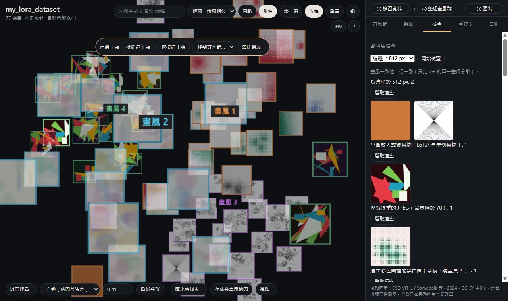
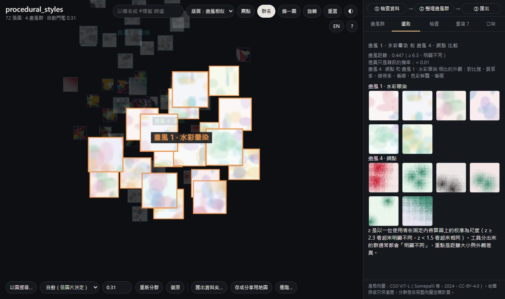
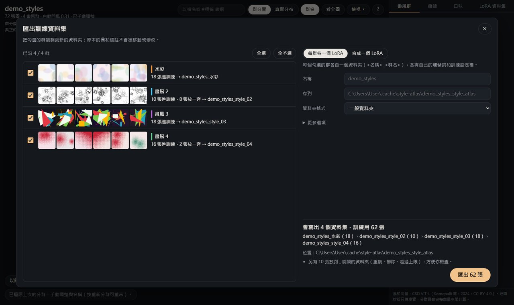
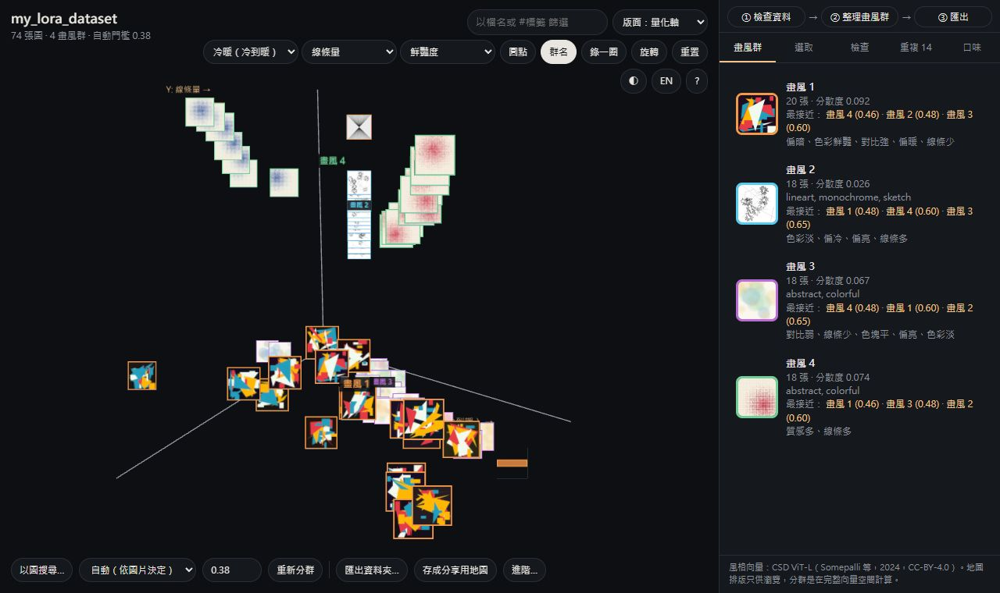

# 網頁介面圖解：訓 LoRA 前的三個步驟

把圖片資料夾拖到 `scripts\StyleAtlas.bat` 上（或直接雙擊它再選資料夾），瀏覽器就會打開下面這個畫面。右側最上方的「① 檢查資料 → ② 整理畫風群 → ③ 匯出」就是整個流程，照順序點即可。

截圖裡的圖片是 `scripts\make_demo_images.py` 產生的抽象圖，不是任何人的作品。

## ① 檢查資料

1. 點「① 檢查資料」，再按「開始檢查」。最上面一行是**畫風一致性**：和 114 位畫師比，這個資料夾的畫風有多分散。顯示「多半混了不同畫風或時期」時，到「② 整理畫風群」把它分開。接著會列出：
   - 太小的圖（短邊可以選 512／768／1024 px）；
   - 小圖放大或很模糊的圖、壓縮很重的 JPEG（LoRA 會學到模糊和壓縮痕跡）；
   - 混在彩色圖裡的黑白圖（例如草稿、漫畫頁），以及其中標註沒有 `monochrome`／`greyscale` 的；
   - 標註寫 `greyscale`、圖卻明顯有顏色的；
   - 長寬比極端的圖、沒有標註或標註是空的、動圖、檔案不完整或打不開；
   - 只靠 EXIF 標記轉正的照片（kohya 會把它橫著訓練）；
   - 標註提到浮水印、簽名或網址的圖。
2. 每一類都有「選取這些」。按下去，地圖上那些圖會亮起來，上方出現一條「已選 N 張」：
   - 「排除這 N 張」：匯出時放到 `_excluded\`，不會拿去訓練；
   - 「恢復這 N 張」：取消排除；
   - 「移到其他群…」：一次移到某一群。
3. 下面的「最不合群的圖」是和整組最不像的圖，也可以逐張點選後按鍵盤 X 排除。
4. 混進了別的畫師的圖時：先排除看到的兩三張，再到同一頁的排除清單按「找更多像這些的」，其餘的通常都會排在最前面。

也可以自己選：按住 Shift 點圖，或按住 Shift 在地圖上拖一個框。Esc 清除選取。選了 2 張以上時，上方的「和…比較」可以拿這些圖和任一群比畫風（例如檢查一批疑似別人畫的圖，是不是真的和這群不同）。想比兩批自己選的圖（例如早期幾張和近期幾張）：先選第一批按「記住這批為 A」，再選第二批按「和 A 比較」。

## ② 整理畫風群

1. 點「② 整理畫風群」，右側每一張卡片是一群：
   - 一句外觀描述，例如「偏冷、線條多」；
   - 「最接近」的 3 群，點一下就跳過去，方便決定要不要合併。
2. 點開一群後可以：
   - 取名（之後的資料夾名稱和觸發詞都會用這個名字）；
   - 「把這群合併到…」「拆成兩群」「找更多像這群的」；
   - 「和…比較」：列出兩群的畫風距離、差異是否明顯，以及外觀差在哪裡。
3. 分得不好時，用左下的分群選單：
   - 同一位畫師的資料夾：選「中」，或選「時期（單一畫師）」再填段數；
   - 很多位畫師混在一起的圖庫（20 位以上）：選「依畫師（20 位以上的圖庫）」，分出的群會比較貼近畫師；
   - 改完按「重新分群」。任何修改都可以按「復原」或 Ctrl+Z 回去。
4. 同樣的角色出現在很多畫風時，打開「進階…」勾選「忽略角色軸」。

## ③ 匯出

匯出的結果放在資料夾旁邊的 `<資料夾名稱>_style_atlas\folders\`（例如 `D:\lora\artistX_style_atlas\folders\`），原本的圖和標註都不會被移動或修改。

點「③ 匯出」（或左下的「匯出資料夾…」），會打開匯出選項：

| 選項 | 用途 |
|---|---|
| 一般資料夾 / kohya | kohya 會做成 `10_名稱_style01` 這種資料夾，並附 kohya（`dataset_config.toml`）、diffusion-pipe、OneTrainer、ai-toolkit 的設定檔 |
| LoRA 名稱（資料夾名） | 資料夾和觸發詞的開頭 |
| 每群最多幾張 | 某群太多時只留這麼多張，會挑能涵蓋整群變化的；其餘放到 `_trimmed\` |
| 要移除的標籤 | 例如 `sketch, monochrome`，匯出的標註裡會拿掉這些標籤 |
| 標註加觸發詞 | 每個標註最前面加上該群的觸發詞 |

之後又加了新圖時，用同一個資料夾重新打開即可：取名、移動、合併和排除都會保留，新圖先放在「未歸類」：點開它，按「各自放進最像的畫風」，夠像的圖會放進最像的群（要和那群七成的圖一樣接近群中心），其餘留著讓你手動處理；這一步可以復原。

按「開始匯出」。kohya 格式會同時附上 kohya、diffusion-pipe、OneTrainer、ai-toolkit 的設定檔（用法見 [LORA_GUIDE.md](LORA_GUIDE.md) 步驟 3）。

## 其他好用的功能

- **以圖找圖**：把一張或幾張圖拖進畫面。結果下方的「把這些複製到資料夾」會連同標註複製到資料夾旁邊新的 `search_matches` 資料夾（擴充訓練集時好用）；幾乎相同的圖會自動收起。拖多張時，還會告訴你這批圖有幾張「落在這個資料夾某一群的範圍內」，可以用來檢查 LoRA 算出來的圖像不像訓練集。拖進來的圖如果和資料夾裡的某張幾乎一樣（同一張圖、裁切或調色），會另外列出來：LoRA 算的圖出現在這裡，代表它可能背下了訓練圖。打開的資料夾底下有子資料夾（例如每位畫師一個）時，還會列出「最像的子資料夾」，點一下只顯示那個資料夾的圖。
- **量化軸**：右上角「版面」切到「量化軸」，X／Y／Z 可以各選一種量測，例如冷暖、線條量、鮮豔度、口味分數、原創度。
- **原創度**：在「進階…」填一個已知畫風的資料夾（畫師作品、配方），按「載入參考」，量化軸就會多出「離參考集距離」。
- **#標籤篩選**：上方的篩選框打 `#monochrome`，只亮出標註裡有這個標籤的圖。這時候以圖搜尋，就只會在這些圖裡找（例如 `#solo` 只找單人圖）。
- **錄一圈**：把 3D 地圖轉一圈錄成 8 秒的影片，可以直接分享。
- **存成圖片**：按鍵盤 P（或「進階…」裡的「存成圖片（PNG）」），把目前的 3D 畫面存成 PNG。
- **存成分享用地圖**：存成單一 HTML 檔，傳給朋友就能打開。
- **存成畫風報告**（在「進階…」裡）：把這個資料夾的畫風整理成一頁：畫風一致性、外觀和 278 位畫師比的位置（例如「比 89% 的畫師亮」）、各群的代表圖，用的是你取好的群名；排除（X）的圖不算在內。
- 按 `?` 看所有快捷鍵；滑鼠停在按鈕上會有說明。
